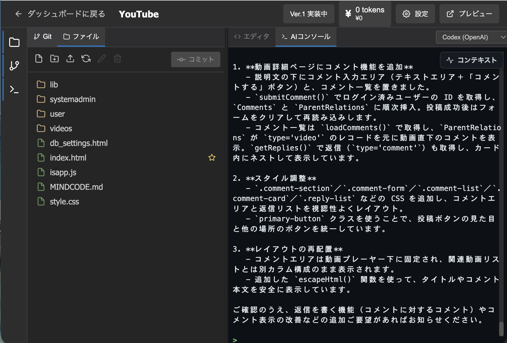
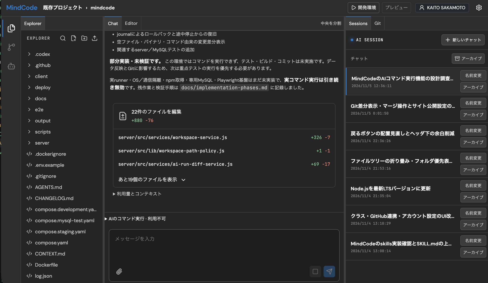
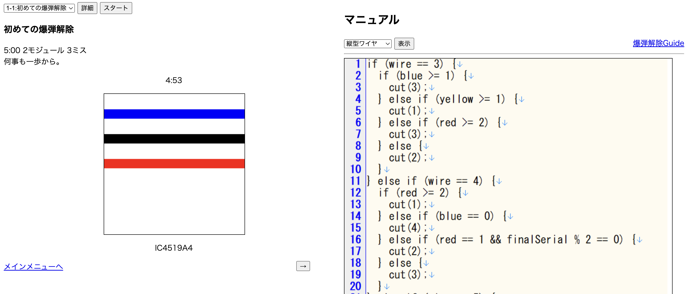

# Kaito Sakamoto

ソフトウェア，ゲーム開発志望 | 学生

## About Me

青山学院大学社会情報学部社会情報学科3年サカモトカイトです．松澤研究室10期生です．研究室のホームページは[こちら](https://creco.si.aoyama.ac.jp/)．

とにかくものづくりが大好きな人です．

大学では社会情報学部として「活用する情報技術」を意識して勉強をしてきました．主にMindCodeの開発をしてバイブコーディングの研究をしています．詳しくは[ここ](#研究活動)で．他に個人的にゲームを少しずつ作っています．詳しくは[ここ](#ゲーム)で．

もっと私のことを知りたいと思ってくださった方は[ここ](./ABOUTME.md)．お友だちになりましょ

---

## プロジェクト一覧
| Project | Preview |
|----------|----------|
| MindCode |  |
| MindCode2 | 
| Puzlog |  |
| 爆弾解除ゲーム |  |

### MindCode

ウェブでバイブコーディングが完結するウェブソフトウェア．お願いしたことをコーディングしてくれて，プレビューができます．

**こだわり**

* 環境構築が不要なので授業で使うときにラク！
* 活動のログを取っているので研究に活用できる！
* MindCodeLogViewerによって分析がしやすい！
* 自動コミット機能で手戻りもラク！
* テストの際にウィンドウを切り替える必要なし！
* テンプレートによって，教材の配布もラク！
* 迷わないUI！

詳しくは[こちら](./projects/mindcode.md)

### MindCode2

今度のMindCodeは操作性が進化！

**こだわり**

* MindCodeMCPを開発しチャット形式で会話可能！
* クラス機能の追加でより授業で使いやすく！
* playwrightを用いた自動テストで効率化！

詳しくは[こちら](./projects/mindcode2.md)

---

## ゲーム

### 爆弾解除ゲーム

プログラミング言語で書かれたマニュアルを読み解き，爆弾を解除するゲーム

１年時の講義の最終課題「社会情報学部らしいサイトの作成」の提出物．最優秀賞を受賞．

**こだわり**

* プログラムを読み解く体験がそのままゲーム体験に！
* 自分で読み進められるチュートリアル！
* シード値の要素を入れ，友達との競技性がUP！
* 改良を重ねたUI！

[ここ](https://tiizu727.github.io/bomb/frontend/)で遊べます

詳しくは[こちら](./projects/bomb.md)

### Puzlog(仮)

パズルとローグライクを組み合わせたドパガキ向けゲーム

**こだわり**

* パズルゲームなのにどんどん脳が溶けていく！
* たくさんのアイテムがあるから何度も出来る！

詳しくは[こちら](./projects/puzlog.md)

---

## 研究活動

### 第175回情報システムと社会環境研究発表会(IS175)

* MindCodeを用いたバイブコーディング活動の分析と上流工程教育の試用結果
* MindCode開発者として参加
* MindCodeのこだわり，分析内容の一部を執筆
* (ただし，ほとんどを教授が執筆．私の書いた部分も意図を汲みながらよりわかりやすく編集．多大なる感謝を...)

IS175のページは[こちら](https://www.ipsj.or.jp/kenkyukai/event/is175.html)

### 情報処理学会 情報教育シンポジウム SSS2026

* MindCodeを用いたバイブコーディング活動の分析と情報システム開発演習の設計
* MindCode開発，ログ分析，論文執筆を行う
* SSS2026にてプレゼン発表を行なう
* 学生奨励賞を受賞
* (論文の書き方などを教授に教わりました．ここでも多大なる感謝を...)

SSS2026のページは[こちら](https://ipsjce.org/sigce/index.php?SSS2026)
* バイブコーディングとプログラミング教育のセッションに入っていますが，プログラミング教育については触れていないです．
* SSS2026は論文を[情報処理学会電子図書館](https://ipsj.ixsq.nii.ac.jp/search?search_type=2&q=1785978652914)に公開していますが，2026年10月28日 (15:00-)のメンテナンスにより今は見られません．

研究室のホームページにはSSS2026のレポートを書いています．[こちら](https://creco.si.aoyama.ac.jp/article/2026-08-sakamoto/index.html)です．

### The Practice of Enterprise Modeling 2026(PoEM 2026)

* MindCodeを用いたバイブコーディング活動の分析と情報システム開発演習の設計
* SSS2026を元に再構築
* (英語に直す作業は教授がやってくれました．共著と言うにはおこがましいくらい私はこの会議に向けた追加の作業をやっていないです...ここでも多大なる感謝を...)

PoEM2026のページは[こちら](https://poem2026.aegean.gr/)

書誌情報は[こちら](https://link.springer.com/book/9783032457523)
* 2026年12月28日に発売されるらしい

## 自宅サーバー

常駐サーバー三台，オンデマンドサーバーが一台家にあります．勉強のために導入し，QoLをあげるためのサービスを上げています．現在は外部からのアクセスを遮断しています．

詳しくは[こちら](./server.md)

## 技術

### Web Development

* JavaScript
* React
* Express
* Vite

### Game Development

* Unity
* C#
* isuzu-MCP

### Database & Infrastructure

* MySQL
* Docker

### Development Tools

* Git
* GitHub

---

## Contact

* GitHub: @Tiizu727
