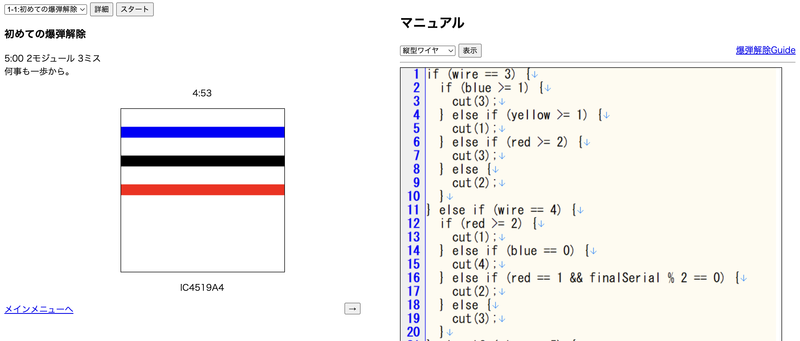
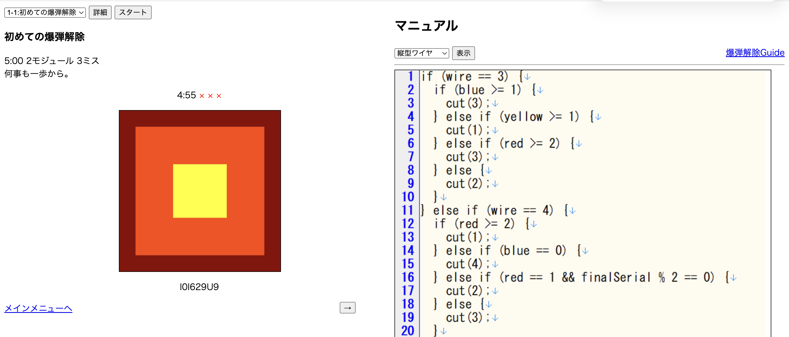
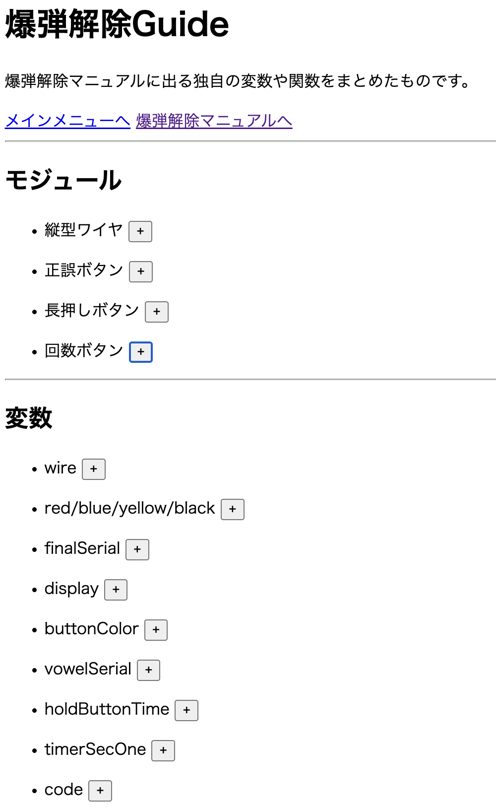

# 爆弾解除ゲーム

## プレイ

[ここ](https://tiizu727.github.io/bomb/frontend/)でプレイできます

## 概要

JavaScriptで書かれた爆弾解除マニュアルを読み解きながら爆弾を解除せよ！

## 作成に至った流れ

学部一年生のHTML,CSS,JavaScriptを勉強する「コンピューティング実習」の最終課題「社会情報学部らしいものを作ってください」に提出するために作りました．

最初に「社会情報学部らしさ」について考えた結果，「プログラミング」と仮定しました．そして，常々「Keep Talking and Nobody Explodes」を一人で出来るようにならないかなぁと持っていました．そこで，プログラミングとの融合が思いつき，一気に構想をまとめることができました．（あとになって考えると，この「融合」も社会情報学部らしくなったんじゃないかなぁを思います）

## こだわり

### プログラムを読み解くゲーム体験

ただ日本語で書かれたマニュアル通りに一人でポチポチするのは楽しくない．そこにリスクを生み出す必要がありました．「Keep Talking and Nobody Explodes」の面白さとはプレイヤーが解除担当とマニュアル担当のコミュニケーションに伝達ミスが含まれている可能性がありながら爆弾を操作することがリスクになっていると思います．では，このゲームでは...？

プログラミング言語という慣れていないものを読み解いて解釈をし，読み間違いが含まれている可能性がありながら爆弾を操作することがリスクとなります．プログラミング言語になるだけでプログラミング初学者にとってはリスクになります．我ながらいいゲーム性だと思います．結果的にシリアスゲームの側面も生み出すこともできたと思います．

### チュートリアル

提出をするにあたって，先生に対して直接説明することができないです．せっかく作ったゲームも操作方法がわからなかったらプレイしてもらえないです．そのため，誰が見ても何をしたらいいのかわかるチュートリアルを作成する必要があります．そこに工夫を詰め込みました．

長々と説明しないこと．実際にプレイさせること．一つの画面に情報を詰め込みすぎないこと．これらを意識しました．あとついでにただ説明されるだけでは味気なかったので「コンピュくん」というキャラクターを作り説明してもらいました．愛着を持っています．

### シード値

MineCraftとかSlay the Spireとかは他の人と共有する面白さがあります．このゲームにも搭載してみたかったのです．

ある値を元にランダムそうな値を作る関数を作成しました．が，今見るとどういう計算なのか...メモの重要性を感じました．AIに聞いてみたら「3乗合同式で内部状態を更新し、その10進表現から桁位置をずらして数値を抽出する独自の疑似乱数生成アルゴリズム」と言われました．あと，一様分布ではないということも言われました．厳しい...

ですが傍から見たら結構ランダムです．もし，これが流行れば面白いシード値が流行ったりしてほしいものです．

### UI

最初完成したときに，友達に協力を仰ぎゲームをプレイしてもらい，UIのわかりやすさについては実験をしました．その時に意識したこととしては何も教えないことです．とりあえずやってみてと言ってプレイさせました．そして，プレイに躓いたり，思っていた行動ができなかったところを教えてもらいそれを改良し，提出しました．

友達の一人に少し色が判別し辛い人がいて，色の違いについて指摘をもらったときはありがたかったです．自分一人ではわからないことを指摘してくれる実験の大切さを知りました．

その後二年生にあがり，友達にプレイしてもらうと，あまりサクサク進まず，プレイをするのに少し戸惑っていました．その人はあまりゲームをしない人でした．ゲームをする人としない人でUIのわかりやすさは変わることを知れました．また，人類に取って誰でもわかりやすい普遍的なUIというは存在しないんじゃないかとも考えるようになりました．

## 受賞

最優秀賞受賞

## 技術

* HTML
* CSS
* JavaScript

## 役割

* 企画
* デザイン
* 実装

## スクショ

## お小言

2026年10月に宮本茂さんが文化勲章を受賞されましたね．そのインタビューの中で
* 「自分が何かのゲームの大ファンだとして、『こうしたらもっと面白くなる』っていうスタートはやめたほうがいい」
* 「『自分がすごく面白かった』っていうところまでは自分が作らないとだめなんです。」
* 「何かをベースに改良するよりは、大元の『こんなことがあったらどうだろう、こんなことをしてみたら面白いんじゃないか』ということを一生懸命作り上げていくほうがきっと楽しいですよ、そのほうが仕事のやりがいがありますよ」

なんてことを仰っていました．このゲームに関しても言えていますよね．精進します．

**出典** 「[マリオの生みの親・宮本茂氏に文化勲章授与。50年のゲーム作りを語る\[記者会見\]](https://www.ndw.jp/nintendo-interview-261023/)」Nintendo DREAM WEB，2026年10月23日公開（2026年11月9日閲覧）．
