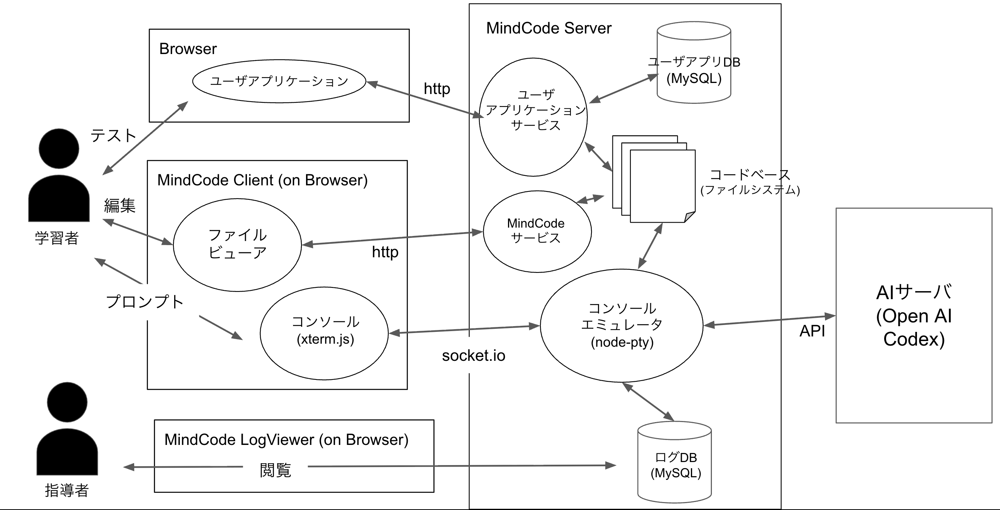
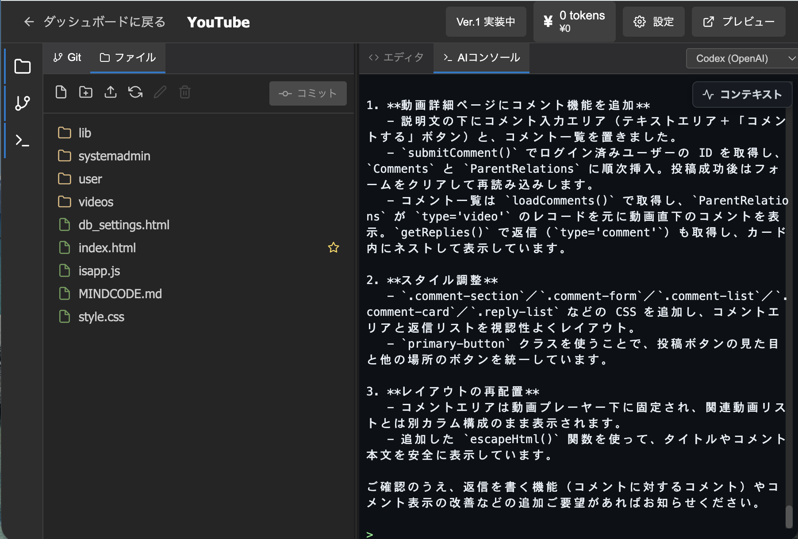

# MindCode

## 概要

Web上でバイブコーディングが出来るサービス．プレビューも同じサービスでできるので，最初から最後までここで完結できます．活動もすべてログを取っています．

## 作成に至った流れ

二年生当時，家のサーバーにMineCraftサーバーを立ててそのサーバーで自作Pluginのテストをしようかなと考えていました．ローカルで作って，ビルドして，scpコマンドを打って，サーバーを起動し直して...面倒くさい．

そこで，サーバー上でプログラムしたりビルドしたりできたらいいんじゃないの？と思いWeb IDEの作成を始めました．当時流行りはじめのCodexやClaudeを搭載しました．それを教授に見せたところ「ログ収集したら研究に出来るよ」となり，研究のためのソフトウェアとして方向転換しました．

## こだわり

### Web上でバイブコーディング

環境構築が不要であったり，APIキーを一元管理できるので学生の負担なしに教育現場に導入することができます．とにかく環境構築が不要になるように実装しました．

またAPIキーを一元管理できるので研究室の人が開発をするときにも個人がサブスクして請求して...などの面倒な事務をなくして開発することができます．

### ログ収集

研究のためにプロンプト本文，プロンプトの入力時間，AI作業時間，AI作業結果，プレビューを収集しました．AI作業時間を取得するために試行錯誤がありました．とても大変でした．プレビュー活動を記録するためにプレビューファイルへのHTTP GETを記録しています．これらのログを取ることでAI作業時間と人間作業時間の割合を出したり，プロンプトの傾向や，より良いプロンプトとは何かを考える際の材料になりました．それらの活動をまとめて論文として発表しました．

### MindCodeLogViewer

収集したログを表示するMindCodeLogViewerという機能も同梱されています．これによって収集したログをplotlyでタイムライン上に可視化しよりラクに分析ができるようになっています．矢印キーで注目する活動を切り替え，詳細にはどのような活動を行ったのかが細かく見れます．

### 自動コミット

AIが作業を行った後に，自動でコミットをするようにしました．これによって，AIが破壊的な変更を起こした時に気軽に手戻りが出来るため，学生は気軽にプロンプトを送信できる仕組みを整えました．また，コミット機能によってAIはどのように変更をしたのかも分析の際に利用できます．（当時のAIは変更を加えたら動かなくなってしまうなどの現象がありました．今は必要ないのかも知れないですね．）

### プレビュー機能

プレビューボタンによってhtmlのプレビューが別タブで開かれ，気軽にテストを行えます．ウィンドウを切り替える必要もないです．

### テンプレート

先生はMindCodeのプロジェクトを配布する際にテンプレートとして配布することができます．学生はプロジェクトを作成する際にテンプレートを選ぶことができ，フォルダのダウンロードやインポートなどが必要なく，スムーズに授業を進めることができます．

### 使用量表示

うちの研究室は資金が潤沢ではありません．そのためIDEの右上にはそのプロジェクトで利用したAPIの推定料金を表示しています．これによって，使いすぎを認識させることができます．破産せずにすみました．

### UI

一つ一つのボタンの位置や文言をこだわりました．利用者はどこを見るのか，利用者が何をしたいときにこのボタンを探すのか，このボタンの近くにこのボタンがあれば利用者は操作をしやすいのか...など．

また，実際に授業で使った際には学生の後ろからモニタリングさせてもらい，どのように操作を間違ってしまうのかを見て，改良を重ねました．

例えば，プロジェクト選択画面の「編集」ボタンには，名前や説明を変更する機能を割り当て，開発画面へはカードをクリックして移動する設計にしていました．しかし，学生や教員はコードを編集しようとして「編集」ボタンを押し，設定画面を閉じてから開発画面へ入り直していました．

そこで，「編集」ボタンから開発画面へ移動できるように変更し，名前や説明の変更は三点メニューに移しました．また，カードのクリックには成果物のプレビューを割り当てました．変更後，初めて使う人は迷わず操作でき，教員からも意図どおりに開発画面へ進めることを喜んでもらえました．一方，従来の操作に慣れた利用者はまた迷わせてしまいました．

UIとしてのより良い方向へ改良しても既存利用者にとってはより良くないため，すべての人にとってわかりやすいUIの難しさを感じました．

## 技術

### AIコーディング

* xterm.js
* socket.io
* node-pty

これらを用いてサーバー上で実行されているCodex CLIをWeb上に描画し，Web上のターミナルでやり取りすることができます．当時MCPなんてものを知らなかったので無理やり実現させました．

### 認証

* Google OAuth

パスワードとかの重要な情報を持つのは嫌です．Googleに移譲しちゃいました．また，大学で使われているアカウントのドメインのみを許可しました．（そのせいで大学のドメインが変更された際に対応できなくなりました．運用は難しいですね）

### その他

* React
* Express
* MySQL
* Docker
* Monaco Editor

## アーキテクチャ

## 研究活動

「第175回情報システムと社会環境研究発表会(IS175)」と「情報処理学会 情報教育シンポジウム SSS2026」にて，このソフトウェアを用いた研究をまとめていました．

## 今後

MindCode2を開発して，そちらに移行する予定です．より便利に使いやすくしています．詳しくは[こちら](./mindcode2.md)

## スクショ

