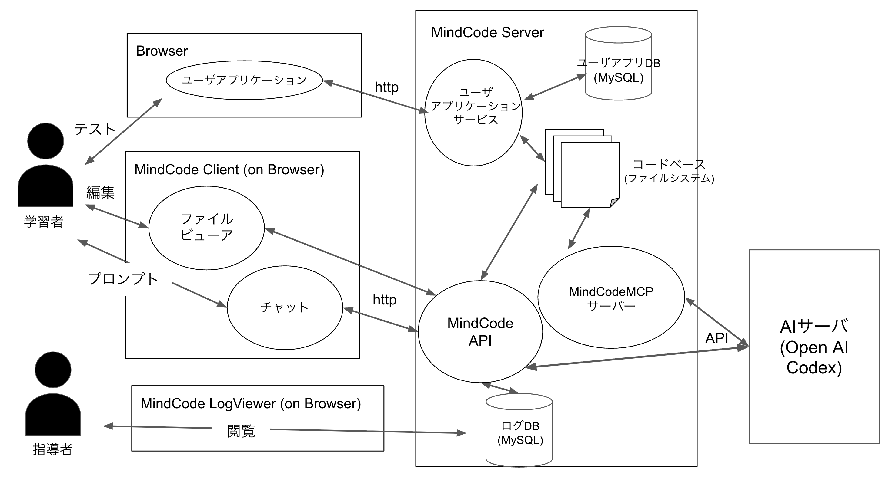
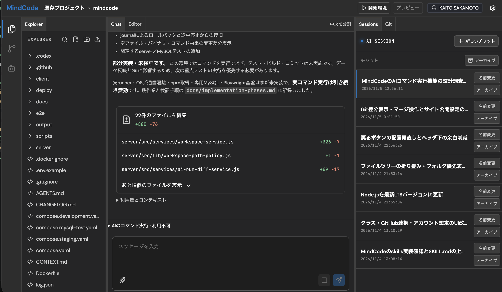

# MindCode2

## 概要

無印MindCodeを改良しました．運用の結果必要なかった機能を削除し，あったら便利な機能を追加しました．

## 作成に至った流れ

25年後期，26年前期と約一年間授業で運用を続けていく中で改良したいことがどんどん溜まっていきました．また，当時と違って上流工程などの進め方などを講義で学んだため，当時のツギハギバイブコーディングではなく「ちゃんとしたバイブコーディング」が出来るのではないかと思い新しいバージョンの作成を決めました．

ここで言う「ちゃんとしたバイブコーディング」とはユースケースを考え，事前に設計をすべて行い，それにあった構成を考えてから実装することです．無印MindCodeはいきあたりばったりな実装で，設計書なんて一枚も書いていません．そのため手戻りが多かったような気がします．定量的な論述はできないですが，気持ち的に設計をしてから実装することでちゃんと意図通りに実装が進んだと思っています．

## こだわり

### MindCodeMCP

MindCodeMCPサーバーを開発することでサーバー上でCodex CLIを呼び出す必要なく，サーバー上のファイルを編集することができるようになりました．そのためみんなに馴染み深いチャット形式で会話ができるようになりました．

25年後期で感想を求めた結果，AIとの会話をする際の操作性の難易度をいくつも指摘されました．その全てはターミナルの操作に慣れていないことが由来しているものです．なのでターミナル形式でAIとの会話をなくし，チャットの形で会話をできるようにしました．

### クラス機能

無印MindCodeにはクラス機能がありませんでした．最初の設計では一つのクラスにしか使わなかったからです．しかし，教授はMindCodeを多くの授業のカリキュラムに組み込み始めたために，他の授業のテンプレートが表示されていたり，ログの分析の際に様々な授業のプロジェクトが混在するようになりました．そのためクラスごとに分ける機能を作成しました．

運用によって設計が変わっていってしまうことを身を持って体験しました．

### 自動テスト

playwrightを用いて自動でテストをできるようにしました．UIに関しては人間がきちんとその意味を考え修正していく必要がありますが，ちゃんと機能をするのかどうかのテストはAIに預けていいのでは無いかと感じ，今回から実装に組み込みました．

機能の実装と同時にplaywrightによるテストも実装し，pushする前にテストを行わせています．AIにテストを実行させると，テストが不合格のときは，AIが自動で修正を行ってくれます．体感的に効率化できていると思います．

## 技術

* React
* Vite
* Express
* MySQL
* Docker
* Monaco Editor

## アーキテクチャ

## 今後

26年後期の授業の中で使われる予定です．よりUIや欲しい機能などを実装していく予定です．

## Screenshots

## お小言

「ちゃんとしたバイブコーディング」ってなんでしょうね．真面目に不真面目みたいな言葉ですよね．AIによるコーディングがすべて「バイブコーディング」とまとまっているのが良くないような気もします．AIを使ったちゃんとしたコーディングについては研究のしがいがありそうですよね．