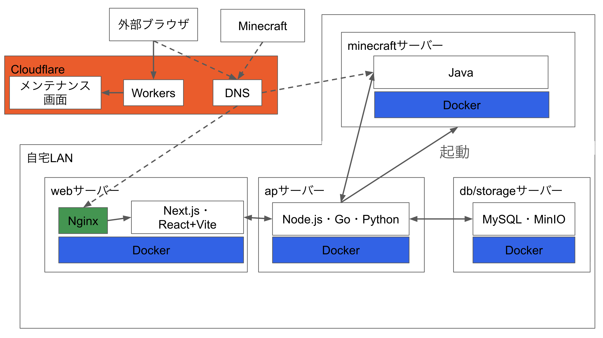

# 自宅サーバー

## 概要

ラズベリーパイ3台を常駐させて，自作のデスクトップのパソコンをMinecraftサーバーとしてオンデマンドに動かしています．

## アーキテクチャ

破線は従来つながってた経路です．今はメンテナンス画面に移動するようにしています．

## 動かしているサイト

### 図書管理システム

家にある本を登録しています．バーコードを読み取ったり，本の検索をできるようにしたり，読了ボタンを作って積読率を表示してみたりなど楽しんでいます．

### 時間割検索システム

大学が提供してる検索システムはあるのですが，使いづらいのです．学年で検索できなかったり，修了した授業も表示されたりと．自分が使っていて「使いづらいな」と思った部分を改良して運用しています．

### ウェブドライブ

GoogleDriveのようにウェブ上でファイルを管理できるサイトです．スマホの写真や動画をここに保管しているため容量に困ったことがないです．

### Minecraftサーバー管理システム

Minecraftのサーバーってバージョンが変わるたびにJavaのバージョンも変わって面倒くさいんですよね．dockerを用いることでその煩わしさをなくしました．またボタンワンクリックで起動や停止もできたり，ウェブ上で設定をしたり，PluginやMODにも対応しています．友達と遊ぶときに重宝しています．

### DiscordBot

サーバーの死活監視をやってくれたり，サーバーに不審なIPアドレスからのアクセスがあった場合に通知を飛ばしたり，毎朝サーバーで使われているパッケージの脆弱性を調査してその報告の通知を飛ばしてくれたりしています．最近多いからね．

## 認証

基本的にCloudflareを用いて私が許可したGoogleアカウントでしかアクセスできないようにしていました．パスワードなどの機密性の高い情報を預かるわけにはいかないですから．友達に私のサービスを利用してもらい，要望をもらって改良していました．

しかし，11月から外部からのアクセスをすべて遮断するようにしました．今の御時世怖いですからね．

